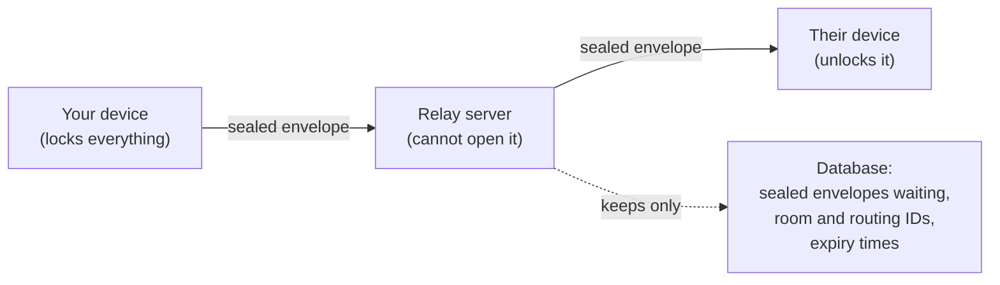
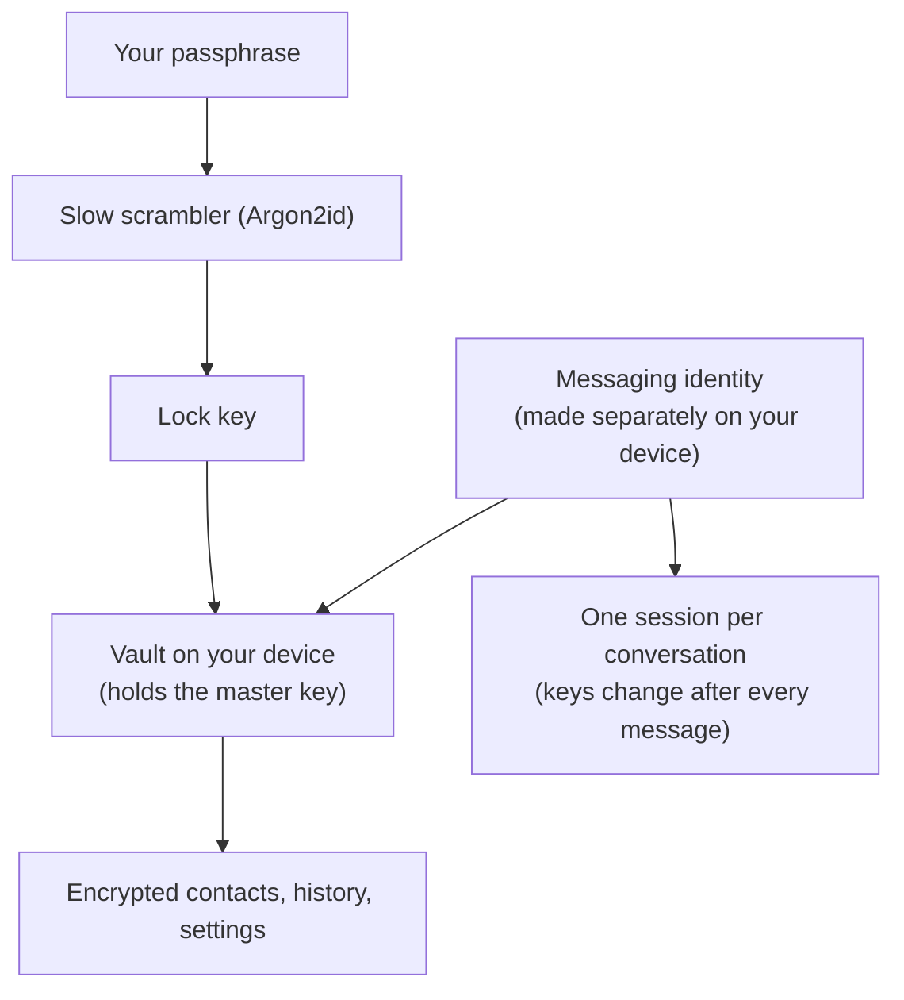
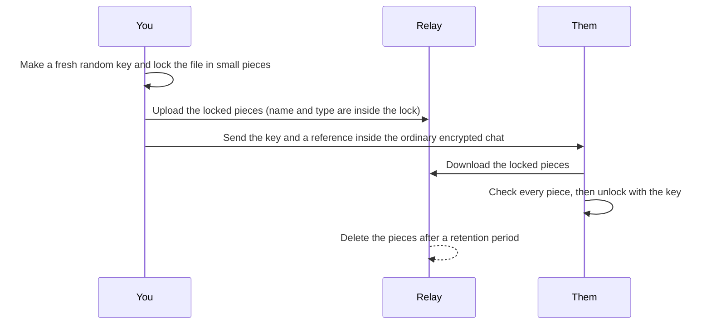
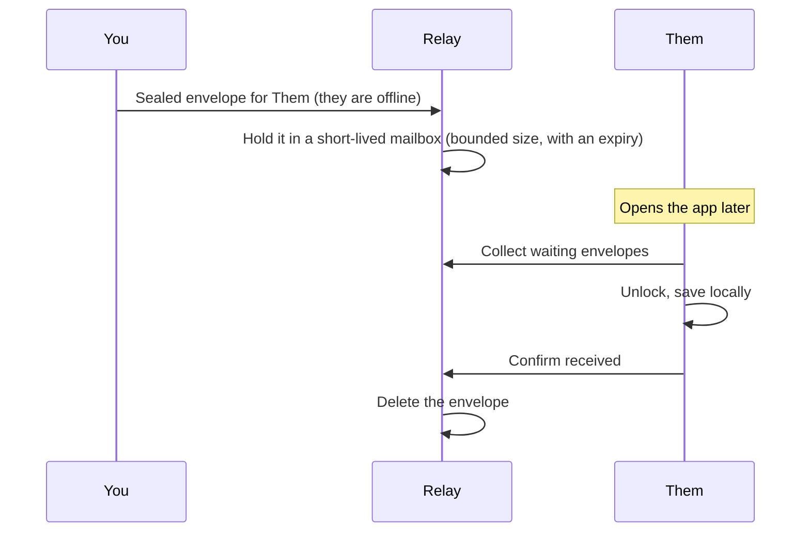

# How K3NCRYPT works (plain language)

This page explains what happens to your messages, files and calls, and what the server can and cannot see. It has no code. It describes the design as documented in this repository; where something is a limit or still unfinished, it says so.

## The short version

- Your messages, files and calls are locked **on your device** before they leave it. Only the person you are talking to can unlock them.
- The server (the "relay") is a post office. It passes sealed envelopes along and holds them briefly if the other person is offline. It cannot open them.
- Nothing about who you are is typed into an account. Your identity is a pair of keys made on your device and kept in a locked vault there.
- The relay still sees **that** two devices talk, **when**, and **how big** the envelopes are. It does not see what is inside.

## 1. What the server sees, and what it does not

| The server sees | The server does not see |
|---|---|
| Your network address (IP) when you connect | What a message says |
| That a conversation exists, its random ID, and when envelopes move | Names of files, or file contents |
| How big each envelope is and the order they arrive in | Your passphrase, your keys, or your contacts' names |
| That a call is being set up, and its timing | Call audio or video (it is encrypted device to device) |

The server can delay, drop or repeat envelopes. It cannot make you accept a forged one, because each envelope is checked on arrival. K3NCRYPT does not hide timing and size patterns from the server, and it does not route traffic through anonymity networks.

**The web version has one extra limit.** The web app is downloaded from the same host as the relay. Someone who took over that host could send you a changed app. That is why the Android app, installed once, gives the highest assurance. The app says this in plain words under Settings → About security.

## 2. Keys and sessions

When you first open K3NCRYPT you pick a passphrase. Here is what that does:

1. Your passphrase is run through a deliberately slow scrambler (Argon2id) to make a **lock key**. Guessing passphrases becomes expensive.
2. The lock key opens a **vault** on your device. The vault holds a random master key, which encrypts everything stored on the device: contacts, chat history, call history, settings such as which chats are muted.
3. Separately, your device makes a **messaging identity** (a long-lived pair of keys). It is not made from your passphrase, so changing your passphrase never changes who you are to your contacts.

Each conversation then gets its own **session**. A session uses a "ratchet": after each message the keys change, so old keys are thrown away. If someone got hold of today's key they could not read yesterday's messages, and the session heals itself going forward. The cryptography is done by **vodozemac**, an open-source Rust library (made by the Matrix.org community) that implements this ratchet; here it runs inside your browser as WebAssembly, and on Android as native code.

## 3. Checking a contact

A secure channel is only useful if you know who is on the other end. K3NCRYPT calls this **checking** a contact.

- Each pair of people has a **security number** (30 digits) that both devices work out independently from their two identities. You compare it with your contact over a different route (in person, or on a phone call), or you scan each other's **QR code**, which does the same comparison.
- If the numbers match, nobody sat in the middle when you connected. The contact is then marked as checked.
- Files and calls are only allowed with a checked contact.
- If the scanner cannot read a QR code, "Show numbers instead" does the same job.

## 4. When a number changes

If your contact gets a new phone, reinstalls, or someone else tries to pose as them, their identity changes, and so does your security number.

- K3NCRYPT notices the change and moves that chat into a **review** state. You can still read old messages, but files and calls stay blocked until you check the new number.
- You decide whether to accept it. Do that over a different route from the chat itself ("Did you get a new phone?").
- Nothing is accepted silently. This is the protection against a stranger quietly taking the place of a contact.

## 5. Files

- The key to a file travels inside the encrypted chat, never to the server.
- The server only holds locked pieces and expiry times. It never sees the file name; the recipient sees the name after downloading, because the name is inside the locked file.
- Every piece is checked as it arrives. A damaged, missing, reordered or expired piece makes the download fail instead of giving you a corrupted file.

## 6. Calls

- A call is set up by exchanging small "how do we reach each other" notes **inside the encrypted chat**, and each is tied to the checked identity. A stranger cannot join by guessing.
- The audio and video then go **directly between the two devices**, encrypted (the standard WebRTC encryption). The relay does not carry call media.
- By default K3NCRYPT contacts no outside help server for calls (that protects your privacy). The cost is that calls between some networks fail. The optional **connection helper**, which you switch on yourself, can fix that; whoever runs a helper server can then see call timing and network addresses, but not content.
- If the other person's microphone or camera drops during a call, you see "Their microphone disconnected" (or camera). It clears by itself when they come back.

## 7. When the other person is offline

- Waiting envelopes are sealed, held for a limited time and in limited number, and deleted when the receiver confirms.
- Today a message is delivered when the receiver next opens the app or connects. A **push wake-up** (a "check now" nudge through Google's service, with no names or text) is being added so a closed phone can tell you something is waiting. See below.

## 8. Notifications, sounds and unread counts

- Sounds, unread numbers and "mute this chat" are decided **on your device**. Muting hides the sound but still shows the unread number. Which chats you muted is stored in the encrypted vault.
- Web notifications say "New message from <the name you gave that contact>". The name comes from your own device; the message text is never in a notification unless you switch previews on.
- A push wake-up, once enabled, carries no names, no text and no sender. It only tells the app "go and check the mailbox". The app then fetches and unlocks the messages itself. Google can see that a wake-up was sent to your phone and when; it cannot see anything about the message.

## 9. What the open-source building blocks do

| Piece | What it does for you |
|---|---|
| **vodozemac** (Rust, from the Matrix.org community) | The per-message key ratchet and identity keys: it makes sure each message has its own key and that old keys are discarded. |
| **Argon2id** | Slows down passphrase guessing. |
| **AES-256-GCM** (built into the browser and Android) | Locks files and stored data, and detects any tampering. |
| **WebRTC** (built into browsers and Android) | Carries calls directly between devices with built-in encryption. |
| **Socket.IO** | The live connection to the relay for passing sealed envelopes. |
| **MongoDB** | The relay's database for waiting envelopes and expiry times. It holds nothing readable. |
| **zbar** (small QR decoder, used if the browser has none) | Reads the contact-check QR code. |

None of these lets the server read your content. They are common, widely reviewed components; K3NCRYPT itself has not had an independent security audit and is in private beta.

## 10. Known limits, in one list

- The server sees who connects when, and the size of envelopes.
- The web app trusts its host (see section 1).
- Some calls fail between certain networks until the connection helper is on.
- The web QR scanner cannot read a small share of QR codes; numbers always work.
- Rooms and devices are not yet cleaned up automatically on the server.
